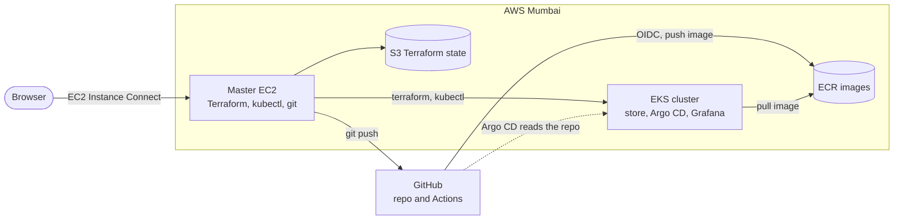
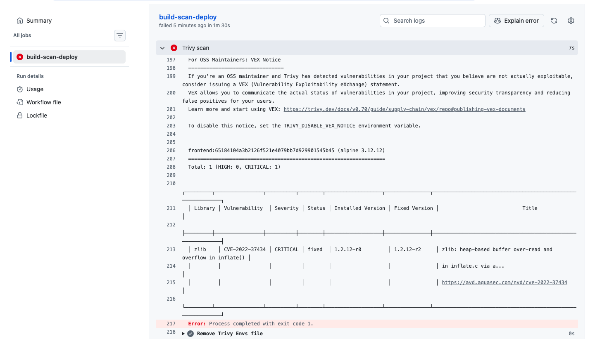
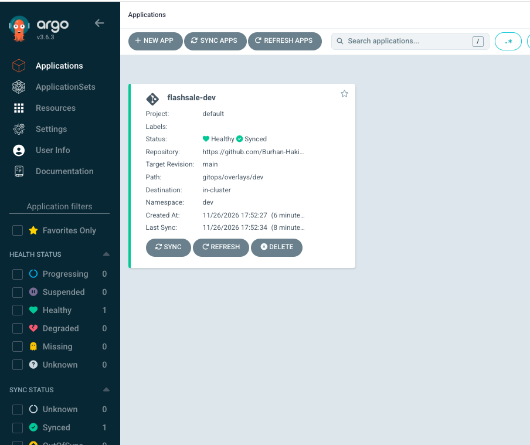
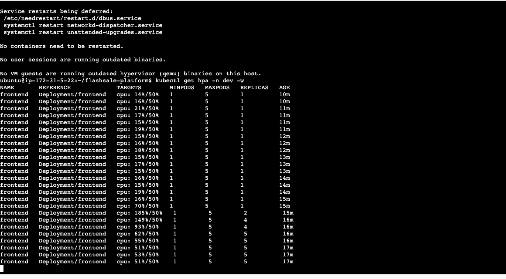
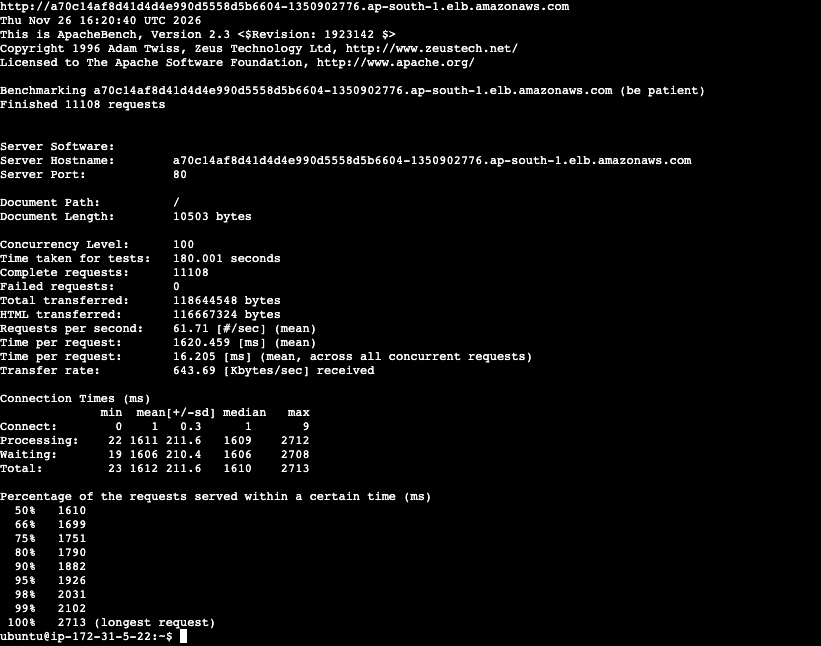
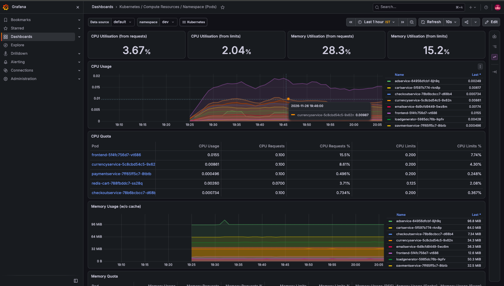
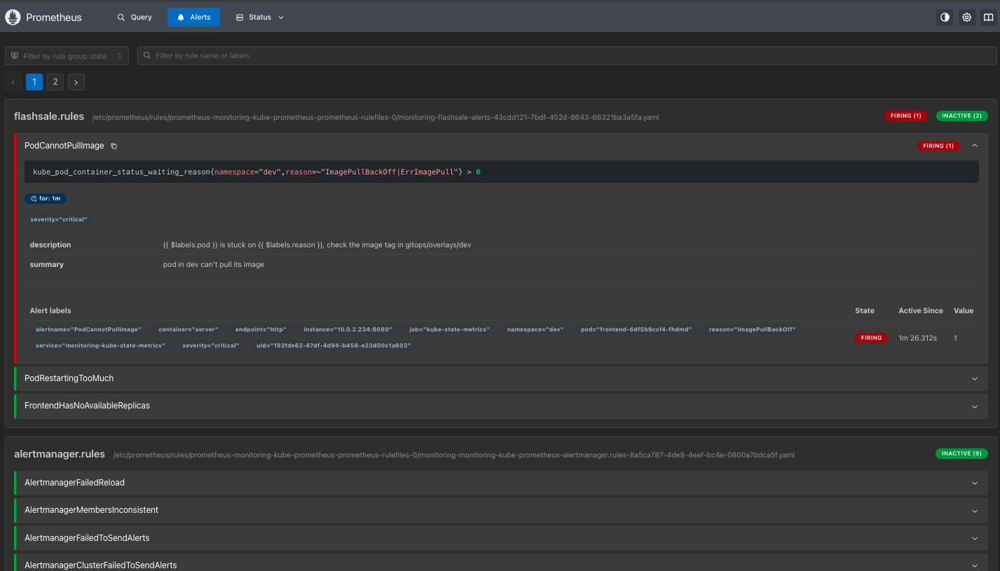
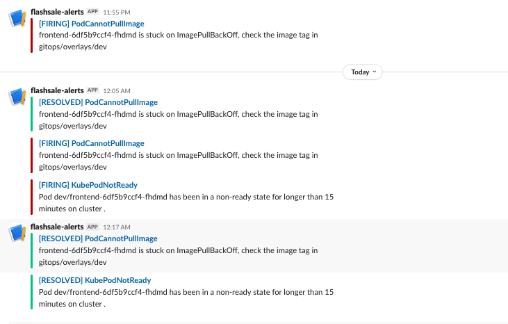
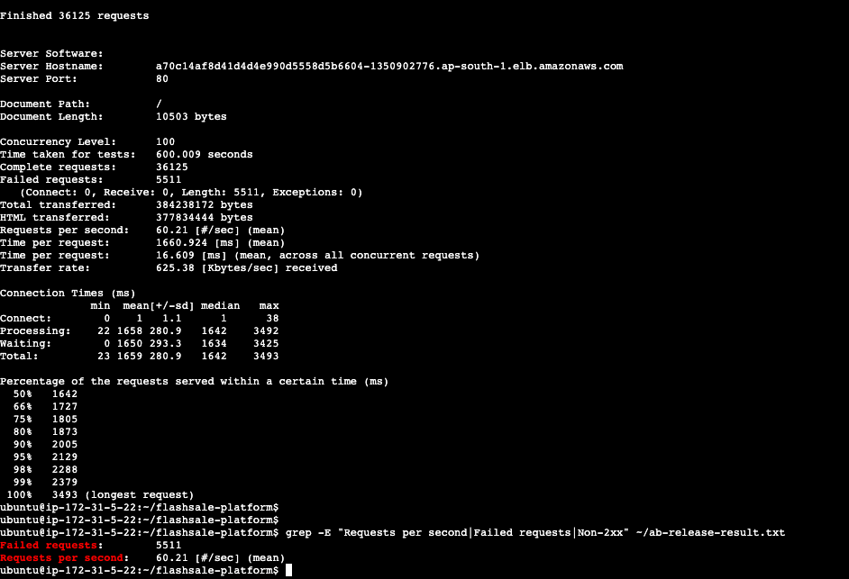
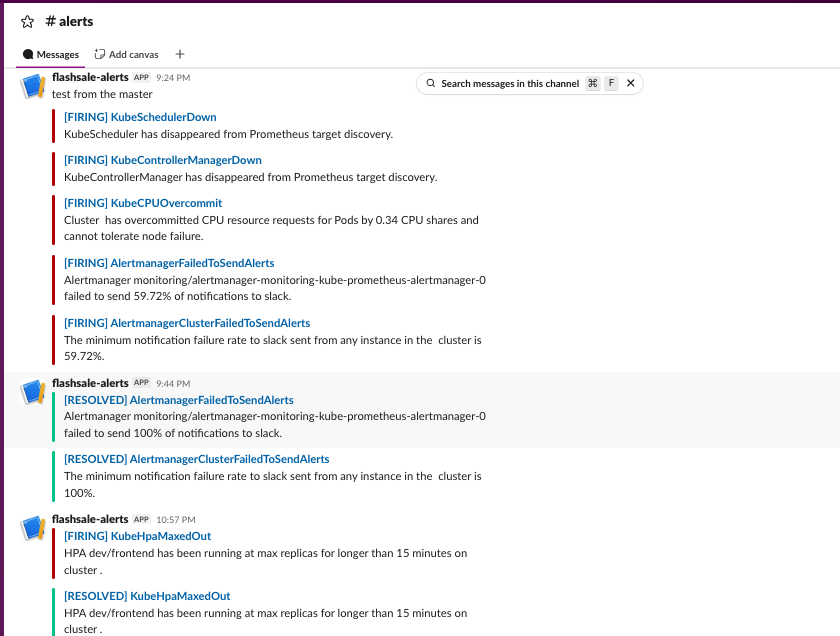

# flashsale-platform

A hands-on project: the delivery pipeline and monitoring for a demo online store on AWS (EKS).

I'm moving into DevOps from electrical engineering and banking, and I wanted one project where a code change goes all the way from `git push` to a running pod, with scanning, monitoring and a rollback I've actually practised. The store is Google's open-source Online Boutique demo (Apache-2.0), so the platform around it is the part I built. Only the frontend goes through my pipeline. The other services run the upstream images.

> I destroyed the cluster after testing because EKS and the NAT gateway bill by the hour, so there's no live demo. The screenshots and numbers are from my own run on 26 to 27 November 2026. All times are IST (UTC+05:30).

## How it fits together

In short: I run Terraform and kubectl from one EC2 box. Terraform builds the VPC, the EKS cluster and an ECR repo. When I push a frontend change, GitHub Actions runs the tests, scans the image with Trivy, pushes it to ECR using OIDC (no AWS keys stored anywhere) and commits the new image tag into `gitops/`. Argo CD sees that commit and updates the cluster. Prometheus and Grafana watch it, alerts go to Slack, and an autoscaler adds frontend pods when CPU climbs.

A couple of extra diagrams (push flow and network) are in [docs/architecture.md](docs/architecture.md).

## What's in the repo

- `infra/`: Terraform for the VPC, EKS, ECR and the IAM role GitHub uses
- `app/frontend/`: the demo frontend, with its original license
- `gitops/`: what Argo CD deploys (Kustomize), plus the monitoring config and the autoscaler
- `.github/workflows/ci.yml`: the pipeline
- `docs/`: the post-mortem, results and diagrams

## Results

| What I measured | Result |
|---|---|
| Cluster build (61 resources) | 11 minutes |
| `git push` to new version running | about 6 minutes |
| Load test (100 users, 3 min): requests per second | 61.7 |
| Load test: failed requests | 0 |
| Load test: time per request | mean 1.6 s, 95% within 1.9 s |
| Frontend pods at peak (limit is 5) | 5, reached in about 1 minute |
| Release in the last 1 to 2 minutes of a 10-minute load test (started at 5 pods) | 0 connect errors, 0 non-2xx, 5,511 length mismatches flagged by ApacheBench |
| Bad release: deploy to alert | about 2 minutes |
| Bad release: deploy to revert pushed | about 21 minutes |
| Bad release: deploy to alert cleared | about 24 minutes |
| Cost of the lab | about $6.3 |

The full table, with notes, is in [docs/results.md](docs/results.md).

## Screenshots

| | |
|---|---|
|  |  |
| *Trivy stopping an old Alpine base image (CRITICAL zlib CVE)* | *Argo CD synced and healthy* |
|  |  |
| *Frontend going from 1 to 5 pods under load* | *Load test summary, 0 failed requests* |
|  |  |
| *Grafana dashboard for the dev namespace* | *Alert firing during the bad release* |
|  |  |
| *The bad-release alerts arriving in Slack* | *Release going live at the end of a load test* |

## What went wrong along the way

- **The Trivy action tag I started with was gone.** My first run failed with "unable to find version 0.28.0". The maintainers had removed the older tags after a supply-chain incident in the action. I moved to `v0.36.0`.
- **Trivy blocked my first real build.** It found 6 HIGH vulnerabilities, in `golang.org/x/net` and the Go standard library from the base image. I updated both instead of lowering the gate, and the scan came back clean.
- **The AWS login failed twice.** First `AWS_ROLE_ARN` didn't hold the full role ARN. Then AWS said "Not authorized to perform sts:AssumeRoleWithWebIdentity". The trust policy looked right, but my repo uses GitHub's newer immutable subject claim, so I added that form to the policy in `infra/github.tf`.
- **Slack alerts failed at first.** I'd saved the webhook secret with placeholder text. Prometheus's own `AlertmanagerFailedToSendAlerts` rule noticed, with about 60% of notifications failing, but that alert couldn't reach Slack until I recreated the secret with the real URL. It then arrived at 21:24 and cleared 20 minutes later.

  
- **Slack also showed alerts I never wrote.** The built-in rules `KubeSchedulerDown` and `KubeControllerManagerDown` fire on EKS because AWS runs those parts and Prometheus can't see them. `KubeCPUOvercommit` was real: my two nodes couldn't survive losing one.
- **A rejected push.** The CI bot commits the new image tag to `main`, so my next push was rejected. `git pull --rebase` fixed it, and I now pull before I push.
- **I cancelled my first release test and forgot what it left behind.** The cancelled run had already scaled the frontend to 5 pods, so the real test started at 5 pods. I only worked that out afterwards from the `KubeHpaMaxedOut` alert timing.
- **"Failed requests: 5511" wasn't what it looked like.** During the release test, ApacheBench counted length mismatches as failures. The connect, receive, exception and non-2xx counts were all zero, and the same page had no mismatches in the earlier test. It's most likely the release changing the page text, but I tore the cluster down before I could check.

## The bad release drill

I pushed an image tag that doesn't exist and watched what happened. The alert reached Slack about 2 minutes later, the old pod kept running, and a `git revert` put things back. The alert cleared about 3 minutes after the revert. Finding the cause took me much longer than the alert did, and the alert also flapped once (resolved, then firing again) while the pod was still broken. The write-up is in [docs/postmortem-bad-release.md](docs/postmortem-bad-release.md).

## Versions I used

| Tool | Version |
|---|---|
| Terraform | v1.17.2 |
| Kubernetes (EKS) | 1.36 (2 x t3.large nodes) |
| kubectl client | v1.37.2 |
| Helm | v3.22.1 |
| Argo CD chart | 10.20.0 (Argo CD v3.6.3) |
| kube-prometheus-stack chart | 93.11.1 |
| metrics-server chart | 3.14.0 |
| Trivy action | v0.36.0 |

## Choices I made

- One environment (`dev`) to keep the cost down. Adding `prod` would be a new overlay folder and an Argo CD app. A flat Terraform folder is fine for one environment, and my separate multi-cloud project covers modules and environments.
- Kustomize for the app and Helm for monitoring. The upstream chart can't override a single service's image cleanly.
- One NAT gateway. It's cheaper, but it's a single point of failure.
- OIDC for the pipeline so there are no long-lived AWS keys to leak. The role can only push to one ECR repo, and only from `main`.
- I pinned the Helm chart versions and the Trivy action. The Go base image uses a floating `golang:1.27-alpine` tag, which stays patched but isn't repeatable. A pinned digest is the opposite trade-off.
- I only autoscale the frontend, because that's what a sale hits first.

## What I'd do next

- A `prod` environment with manual approval in Argo CD.
- An ingress with TLS and a domain.
- Node autoscaling (Karpenter or the Cluster Autoscaler). The autoscaler adds pods but my node count is fixed, and the frontend sat at its 5-pod cap during both load tests (Slack's `KubeHpaMaxedOut` alert fired).
- Turn off the built-in alert rules that can't work on EKS (scheduler and controller manager), so the Slack channel only shows alerts that mean something. Add the failing image name to my own alert text, and try `keep_firing_for` so the pull-failure alert can't flap.
- Look at the frontend's CPU limit (200m, with a 100m request). Response times stayed around 1.6 s under load, which could be throttling, but I haven't confirmed it.
- Pin third-party actions to a commit hash, and protect `main` so only the pipeline writes image tags.
- SLOs with a burn-rate alert, and persistent storage for Prometheus.
- A least-privilege role for the master (I used AdministratorAccess for a short lab), Session Manager instead of SSH, and a private EKS endpoint.

## Limits

Single region, small nodes, a demo app, and monitoring data that resets when pods restart. The store's own load generator was running during my tests, and `ab` only hits the home page. Latency was about 1.6 s per request, so this shows the store stayed up and scaled, not that it's fast. The release test started with the frontend already at 5 pods, so it shows a release under load, not scale-out. I sent no traffic during the bad-release drill, so I can't say whether customers would have seen errors. The EKS API was public but limited to one IP, and there's no ingress or TLS.
